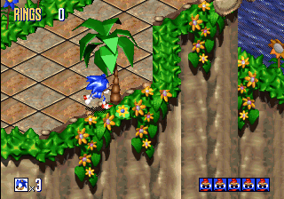
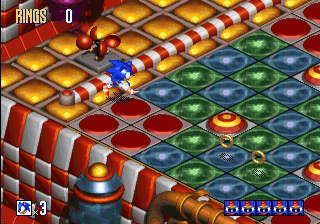
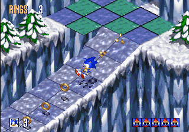
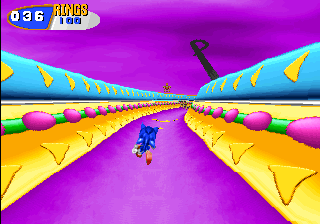

# Sonic 3D Blast — native core with LÖVE

I’m reconstructing the PC version of Sonic 3D Blast so I can run it through LÖVE. I translate the original x86 game logic into C ahead of time and use LÖVE for the window, input, audio, and movies. The port runs the original routines and reads the original data formats. I’m still checking how closely its timing and behavior match the PC game.

## Screenshots

I captured these frames from my running PC reconstruction at its native 320 × 224 resolution. In regular stages, the `RINGS` label flashes when the count is zero. I chose frames that show the label and count at the top, plus lives and the five Flicky slots at the bottom. In the special stage, the HUD shows 36 rings toward a target of 100. The original game artwork belongs to its respective rights holders. [Game material notice](NOTICE)

| Green Grove | Spring Stadium |
| --- | --- |
|  |  |

| Diamond Dust | Special stage |
| --- | --- |
|  |  |

## Play on this machine

```sh
cd sonic3d-love
./play.sh
```

Arrow keys move. **Enter** pauses or selects; **Z/A**, **X/B** and **C** are the original A, B and C buttons. **F11** toggles fullscreen; **Ctrl+Q** quits. Enter, Escape or Space skips a movie. Gamepads are supported. Saves go into `saves/`; set `SONIC3D_SAVE_DIR` to use another directory.

## Android LÖVE build

```sh
make android
# Or choose installed toolchains explicitly:
python3 tools/build_android.py --sdk /path/to/Android/Sdk --ndk /path/to/NDK
```

The builder needs the extracted game, generated native sources and decoded movies from setup, plus an Android SDK/NDK, Java, Make and curl. It verifies pinned LÖVE 11.5 and apktool downloads, compiles the native engine for **ARM64 / Android 5.0 or newer**, embeds the game data and signs a standalone `Sonic-3D-Blast-Love-Android.apk` under `builds/android/<timestamp>/`. LÖVE does not need to be installed separately. The engine uses 128-bit integers, so 32-bit Android devices are not supported.

Install the APK and launch **Sonic 3D Blast**. It has a geometric launcher icon, landscape orientation, a multitouch direction pad, A/B/C and Start buttons. The picture scales to the available height while keeping its original proportions. Desktop integer scaling remains available; `love game --touch-controls` previews the phone controls and scaling on desktop. A, B, C or Start can skip movies.

The first launch shows a progress screen while preparing the original files in private app storage. Later launches reuse them. An interrupted preparation can safely restart, and updates preserve the separate `saves/` directory. No storage, microphone or network permission is needed. Keep `build/android-signing/` private and backed up: future APKs need that same local key, and a higher `--version-code`, to update an installed copy without uninstalling it.

## Build from the disc

Tested on Linux x86-64 with LÖVE 11.5, GCC, Python 3.14, Ghidra 12.1.3 and Java 21. Setup requires Python 3.10+, a C compiler, Make, 7-Zip, FFmpeg/FFprobe and Ghidra. Configure `GHIDRA_HOME` or `ANALYZE_HEADLESS` if Ghidra is not on the local search path.

```sh
python3 tools/setup.py --iso /path/to/Sonic3D.iso
./play.sh
```

Setup verifies and extracts the disc, analyzes the executable in a new Ghidra project, translates 164,603 recovered instructions, builds the native core and decodes the three original movies. Existing extracted source files are verified and preserved. Analysis and generated artifacts stay local. The first build takes several minutes.

The supported disc SHA-256 is:

```text
6f1d49b2cde457e3b195f9f2bc7f618179ce3d0e2f290c07c14d3fe2f8f197f2
```

The supported `PCSONIC.EXE` SHA-256 is:

```text
2cb33a8629e1de8c4f9688123a35f6c0bffb5ba53f05f75a3e2aae8c1e3a25dd
```

Use `--source /path/to/extraction` for an existing extraction and pass the same option to `play.sh`. `setup.py --analyze` forces a fresh analysis. `--skip-movies` omits decoding; also pass that option when playing. Normal launches rebuild changed C files incrementally.

## Validation and remaining work

```sh
make check
bash tools/check_frontend.sh
```

The ten native integration tests cover boot, controls, pause, save/load, act progression, boss-flash palette cleanup across zone changes, death/continue/game over, all 21 regular and boss stage entries, all seven special stages and their rewards, the final boss, both endings, credits and Exit. They inject original state at progression boundaries; they are not full recorded playthroughs.

`make check` also verifies portable x87 number conversion for ARM, multitouch button mappings at three screen sizes, and Android asset preparation, including interrupted writes, repair, updates and save preservation. Device performance and audio listening still require testing on a phone.

The frontend checks require Xvfb and LÖVE. They use a private display and isolated saves, check the original movies' rendered pixels and completion, run a gameplay input replay and exercise Exit. Audio starts using a null device during automation; listening verification remains manual. Results are written under `research/` and `captures/`.

A fresh Ghidra analysis reproduced the working instruction export exactly. A full original-versus-port playthrough comparison, original timing/motion-smoothing comparison, audio listening checks and testing on other operating systems remain outstanding. Passing the current tests does not establish every level interaction or exact audiovisual timing.

## Layout

- `game/`: LÖVE frontend and handwritten native compatibility layer.
- `tools/`: executable analysis, C generation, asset preparation and headless Python helpers.
- `tests/`: integration tests and deterministic input replays.
- `source/`: local disc extraction, excluded from source control.
- `research/`: local analysis, reports and build experiments, excluded from source control.

See [NOTICE](NOTICE) for original-game material.

The [MIT License](LICENSE) covers original source in this repository. Supply your own game disc as described above.
